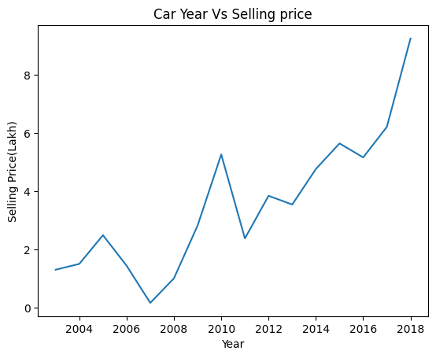
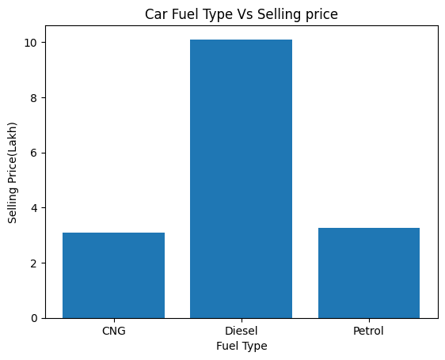
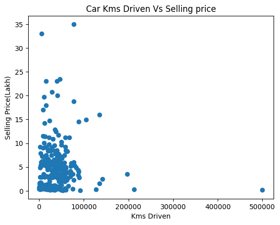
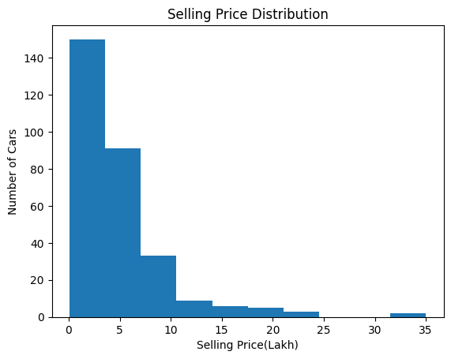
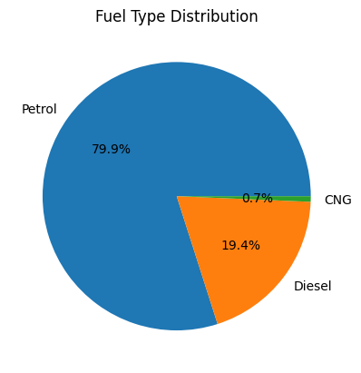
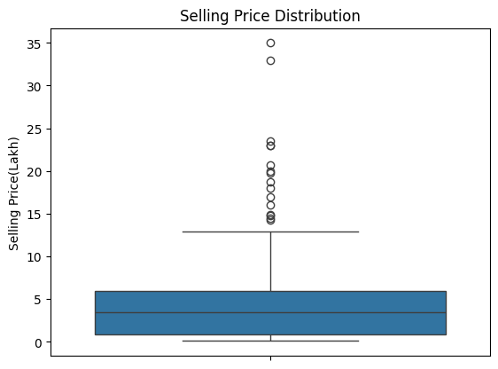
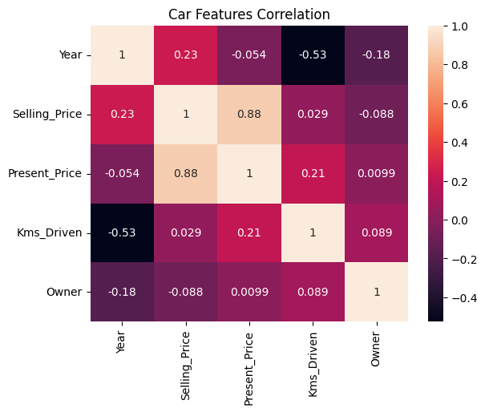
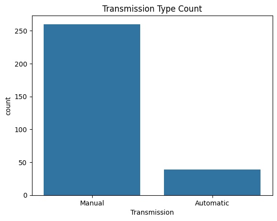

# Used Car Price Analysis using Python

[](https://colab.research.google.com/github/kapilarif/Used-Car-Price-Analysis-Python/blob/main/car_price_analysis.ipynb)

An exploratory data analysis project on second-hand car data from CarDekho. It finds out which factors affect the selling price of a used car, using **NumPy, Pandas, Statistics, Linear Algebra, Matplotlib and Seaborn**, and estimates prices from group averages **without machine learning**.

## Objective

To analyze used car records, understand which factors (present price, year, kilometres driven, fuel type, transmission, seller type) are related to the selling price, and make a simple statistical price estimate.

## Dataset

- **Source:** CarDekho Used Car dataset (Kaggle), file `car data.csv`
- **Size:** 301 rows, 9 columns (299 rows after removing 2 duplicates, no missing values)

| Column | Description |
|---|---|
| Car_Name | Name of the car model |
| Year | Year in which the car was bought |
| Selling_Price | Selling price in lakhs |
| Present_Price | Current ex-showroom price in lakhs |
| Kms_Driven | Kilometres driven |
| Fuel_Type | Petrol, Diesel or CNG |
| Seller_Type | Dealer or Individual |
| Transmission | Manual or Automatic |
| Owner | Number of previous owners |

## What the project covers

| Topic | What was done |
|---|---|
| **Pandas** | Loading, inspection, missing-value and duplicate check, cleaning, GroupBy comparisons |
| **NumPy** | Mean, maximum, minimum and standard deviation of the selling price |
| **Statistics** | Median, mode, variance, standard deviation, correlation matrix |
| **Linear Algebra** | Matrix addition, determinant, inverse and matrix multiplication on car data |
| **Matplotlib** | Line, bar, scatter, histogram and pie charts |
| **Seaborn** | Boxplot, correlation heatmap and count plot |
| **Price estimation** | Estimated price from Fuel Type + Transmission group averages (no ML) |

## Key findings

- Average selling price is **4.59 lakhs** (median 3.51 lakhs), ranging from 0.1 to 35 lakhs.
- **Present Price has the strongest relationship with Selling Price (correlation 0.88).**
- Kilometres driven alone has a very weak linear relationship with price (0.03); Year and Kms_Driven are negatively correlated (-0.53).
- Diesel cars have the highest average price (10.10 lakhs) compared with Petrol (3.26) and CNG (3.10).
- Automatic cars average 9.07 lakhs against 3.92 lakhs for Manual cars.
- Estimated price of a **Diesel, Manual** car from the group average: **7.67 lakhs**.

> The estimate is based on historical group averages and is only approximate. The dataset is small, so a few expensive cars can affect the averages.

## Visualizations

**Matplotlib**

| Line chart: average price by year | Bar chart: average price by fuel type |
|---|---|
|  |  |

| Scatter plot: kilometres vs price | Histogram: price distribution |
|---|---|
|  |  |

| Pie chart: fuel type share |
|---|
|  |

**Seaborn**

| Boxplot: selling price | Heatmap: correlation |
|---|---|
|  |  |

| Count plot: transmission type |
|---|
|  |

## How to run

1. Click the **Open in Colab** badge above (or upload `car_price_analysis.ipynb` to [Google Colab](https://colab.research.google.com/)).
2. Run all cells (Runtime > Run all).
3. When the first cell asks for a file, upload `car data.csv` from this repository.

Python libraries used: `pandas`, `numpy`, `matplotlib`, `seaborn` (all pre-installed in Colab).

## Repository structure

```
Used-Car-Price-Analysis-Python/
├── car_price_analysis.ipynb   # Full analysis notebook
├── car data.csv               # Dataset
├── images/                    # Charts used in this README
└── README.md
```

## Future improvements

- Use a larger dataset with more brands and cities
- Add machine learning models for price prediction
- Build a dashboard or small web app for price estimation

## Author

**Kapil Arif K**
B.E. Computer Science & Engineering, PSG College of Technology
[GitHub](https://github.com/kapilarif) | [LinkedIn](https://www.linkedin.com/in/kapil-arif-295751358/)
